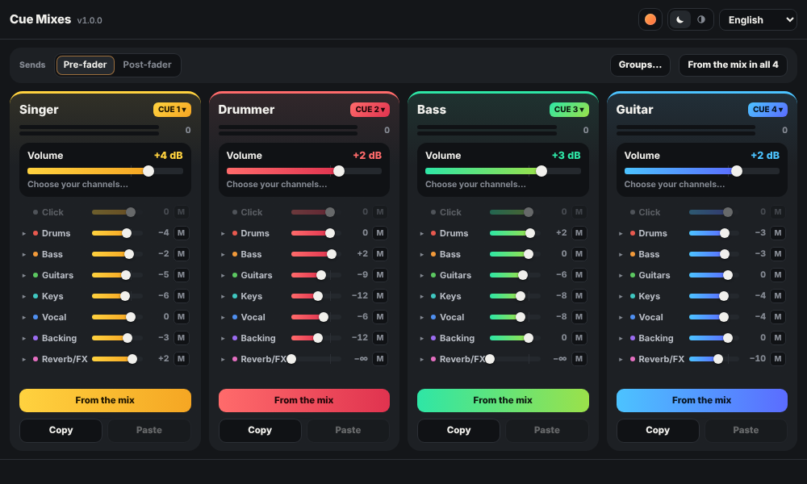
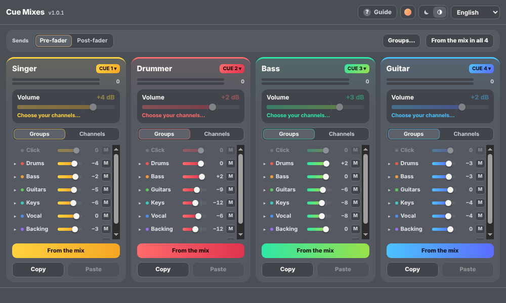

# Cue Mixes for LUNA

Four headphone mixes for recording, built on LUNA's cue sends: start each from your faders, move
groups and channels, give every musician more of themselves, copy and paste between cues. Your
main mix is never touched.

  
  

## Features

- **Four cues, four colours:** one column per cue (CUE 1–4), named after the musician, yellow, red,
  green and blue by default; click the CUE label to pick another of the seven colours.
- **From the mix:** a cue takes the level, pan and mute of every channel in your mix as its
  starting point (counting the sub-mix buses each one goes through); **From the mix in all 4**
  does it for every cue at once. The click is never taken muted.
- **Group faders:** one fader per group in every cue, relative to that starting point, with its
  own mute. **Click** is always there; the rest are the session's own groups.
- **Groups your way:** in **Groups…** every channel shows its group as a coloured chip; click it to
  change it, filter by audio, instruments, buses or no group, rename, add and delete groups, or
  let **Suggest from names** sort them (kick, bass, gtr, keys, vox, BV, reverb…).
- **Groups or channels, per cue:** each cue switches between **Groups** (open a group with ▸ to
  retouch its channels) and **Channels**, every channel on its own fader.
- **Volume:** choose the musician's own channels and turn them up or down (−24 to +12 dB) against
  everything else.
- **No double signal:** a bus your channels go through (a drum or vocal sub-mix) stays silent in
  the cues, which take its channels one by one; reverb and other send buses work as usual.
- **Copy and paste:** copy one cue and paste it into another as a starting point; the musician's
  own volume and channels stay theirs.
- **Pre- or post-fader** cue sends, a meter and level for each cue bus.
- **Safe:** opening Cue Mixes changes nothing anyone hears; new channels join without changing a
  cue; your main mix is never written. Names, colours, groups and cues are saved in the session
  itself, so they travel with it.
- **Your colour:** yellow, orange, red, green, blue, pink or purple; dark and grey themes.
- **7 languages:** English, Español, Català, Français, Deutsch, Italiano and Português.

## How to use it

1. Open **Groups…** and check which group each channel is in.
2. Press **From the mix in all 4** to give every musician your mix as a start.
3. Name each column, pick their channels under **Volume**, and move the group faders as they ask.

The first time it opens, it asks for your language and then a short guide walks you through the
window in it; the **Guide** button brings it back whenever you need it.

Which output or headphones each cue reaches is set in LUNA and on your interface, as usual.

## Support

If something does not work as expected, Alt-click the version number at the top of the window:
it copies a short report to paste in a message to fedetrillo@gmail.com.

## Install

Requires LUNA 3.1.2 or later. Install it from LUNA's Add On marketplace, or download
`cuemixes.lunaaddon` from the latest release and double-click it. Then open a session and
choose **Add Ons > Windows > Cue Mixes**.

## En español

Cue Mixes monta las cuatro mezclas de auriculares de una grabación sobre los envíos de cue de
LUNA. Cada músico tiene su columna con su color: parte de tu mezcla, mueve grupos o canales
sueltos, sube o baja lo suyo con "Volumen" y copia y pega entre cues. Los grupos los decides tú, con
el Click siempre presente. Tu mezcla principal no se toca nunca. Modo oscuro y gris, siete
colores, 7 idiomas.

## Licence

Copyright (c) 2026 Fede Trillo. All rights reserved. Free to install and use in LUNA; the code
may not be copied, modified or redistributed. See [LICENSE](LICENSE). The bundled LUNA Builder
SDK is Universal Audio's, under the Apache License 2.0: see
[THIRD_PARTY_NOTICES.md](THIRD_PARTY_NOTICES.md).

Contact: fedetrillo@gmail.com
